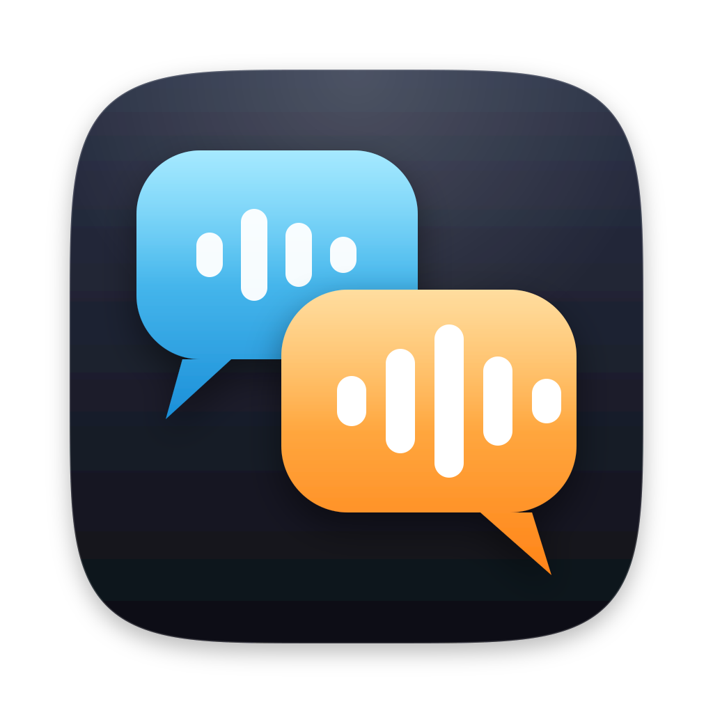
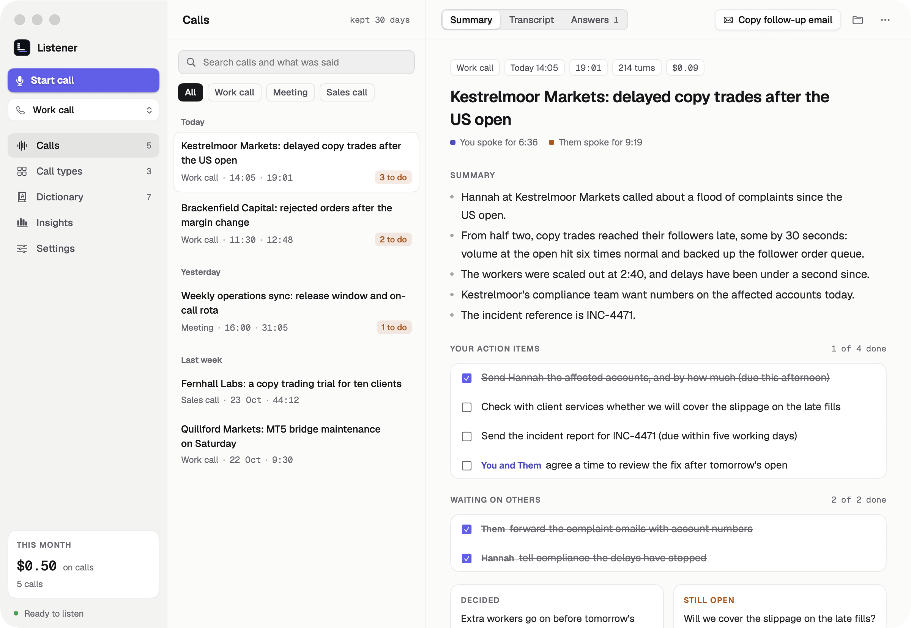
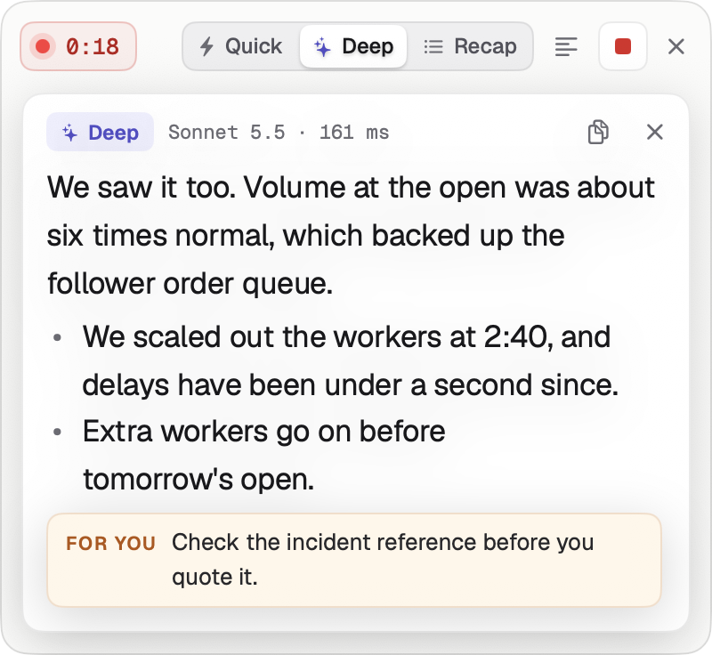
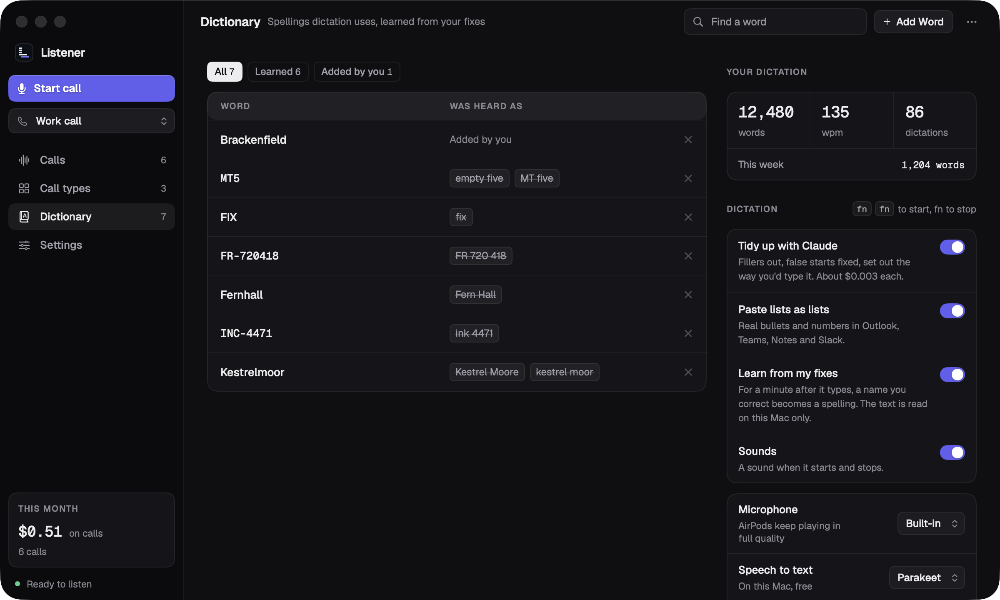
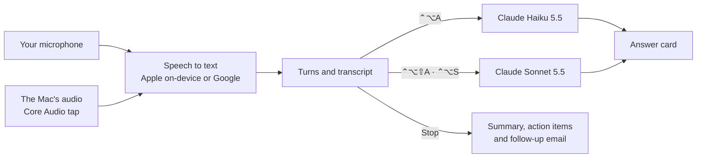

<p align="center">
  
</p>

<h1 align="center">Listener</h1>

<p align="center">
  <strong>Live answers on your calls, and dictation everywhere else.</strong><br>
  A native macOS app that hears both sides of a call and hands you the right thing to say, powered by Claude.
</p>

<p align="center">
  <a href="https://github.com/charlesarthurking7-commits/listener/actions/workflows/ci.yml"></a>
  
  
  <a href="LICENSE"></a>
</p>

<p align="center">
  
</p>

Listener sits in your menu bar. Start a call and it transcribes you and everyone else
live, in a slim window that floats over Meet, Teams or Zoom without ever taking the
keyboard. Press a hotkey and Claude streams an answer to what was just asked. When the
call ends it writes the notes: what was said, what you agreed, what you have to do, and
a follow-up email. Between calls, press fn twice in any app and speak.

## On a call



- **Both sides, live.** Your microphone is "You" and the Mac's audio is "Them", through
  a Core Audio tap: no virtual audio driver to install.
- **Answers on a hotkey.** A quick answer from Claude Haiku 5.5 starts in well under a
  second; a deep one from Claude Sonnet 5.5 takes on harder questions; a recap reads
  the whole call so far. Notes meant only for you are kept apart from the words to say.
- **Grounded.** Answers may use general knowledge but never invent the call's facts:
  amounts, account or ticket numbers, dates or names. They say what to check instead.
- **Call types.** Work call, Meeting or your own, each with its own instructions and
  background: drop in documents, paste a page or its link, or write a brief.
- **Out of the way.** The window never takes focus, sizes itself to what it shows, and
  hides its contents from screen sharing.

<br clear="right">

| Shortcut | What it does |
| --- | --- |
| <kbd>⌃</kbd><kbd>⌥</kbd><kbd>L</kbd> | Start or stop listening |
| <kbd>⌃</kbd><kbd>⌥</kbd><kbd>A</kbd> | Quick answer |
| <kbd>⌃</kbd><kbd>⌥</kbd><kbd>⇧</kbd><kbd>A</kbd> | Deep answer |
| <kbd>⌃</kbd><kbd>⌥</kbd><kbd>S</kbd> | Recap so far |
| <kbd>⌃</kbd><kbd>⌥</kbd><kbd>H</kbd> | Show or hide the floating window |

## After the call

Every call is kept on your Mac with its transcript, the answers you were given and a
summary: a title saying who it was with and what about, decisions, open questions, a
follow-up email to copy, and action items you tick off, with yours apart from the ones
you are waiting on. Search finds any word said on any call. Each call shows what it cost.

## Dictation, in any app



Press fn twice, speak, and press fn again. The words are recognised on the Mac by
Parakeet Ultra on the Neural Engine, then tidied by Claude for the app you are typing
into: fillers and false starts gone, corrections applied, and lists pasted as real lists
in Outlook, Teams, Notes and Slack. Fix a name it got wrong and it learns the spelling
for next time. The Dictionary page counts your words and your speed.

## How it works



Each answer gets the recent conversation, the call type's instructions and background,
and a line about you. The background is held in Claude's prompt cache for the call, so
even a CV and a job description add no noticeable time. Every answer logs its timings
from end of speech to first word, and the costs are tracked per call.
[docs/PLAN.md](docs/PLAN.md) explains the architecture and the decisions behind it.

## Privacy

- **Nothing is recorded until you press Start**, and while Listener listens a pulsing
  red chip and a filled menu bar icon say so. The window can hide its contents from
  screen sharing; the recording itself is never hidden from you.
- **Calls stay on your Mac**, under `~/Library/Application Support/Listener/sessions`,
  for 30 days. Audio is not kept unless you turn it on.
- **Speech is recognised on the Mac** by default (macOS 26 and later); Google
  Speech-to-Text in the EU is the alternative. What was said goes to Anthropic for
  answers and summaries, and the API key lives in the Keychain.
- **Dictation keeps no audio and nothing you dictate**: only the spellings it learned
  and daily word counts.

Laws on recording calls differ between countries and states, and many need everyone's
consent. Tell the people on the call when Listener is listening.

## Requirements

- Apple Silicon Mac, macOS 15 or later (macOS 26 or later for on-device speech).
- Xcode 26 or later, or its Command Line Tools (`xcode-select --install`).
- A microphone that works with the lid closed (the built-in mics are off in clamshell
  mode), and headphones on calls so the mic does not hear the other side.
- An [Anthropic API key](https://console.anthropic.com/) for answers, summaries and
  dictation's clean-up.
- For Google speech-to-text only: a GCP project with the Speech-to-Text API enabled and
  `gcloud auth application-default login`.

## Quick start

```sh
git clone https://github.com/charlesarthurking7-commits/listener.git
cd listener
scripts/run.sh                                                    # build and open the app
build/Listener.app/Contents/MacOS/listener secrets set anthropic   # store your API key
```

Or paste the key into **Settings**, under API key. On macOS 26 and later that is all:
speech recognition runs on the Mac. On older systems, pick Google Cloud under
**Settings**, Speech. Fill in **About you and your calls** under Answers so answers fit
your role (see [`settings.example.json`](settings.example.json)), then press **Start
call** or <kbd>⌃</kbd><kbd>⌥</kbd><kbd>L</kbd>.

To try it without a call, `listener demo` plays a recorded call into the window, and
`listener replay` runs a fixture call through the whole pipeline in the terminal:

```sh
listener replay Fixtures/delayed-executions/me.wav Fixtures/delayed-executions/them.wav \
    --script Fixtures/delayed-executions/script.json --ask-at 0:30,0:39
```

[docs/USAGE.md](docs/USAGE.md) covers everything else: both windows, hotkeys, call types,
dictation, the terminal, replay, settings, API keys, where files go and troubleshooting.

## macOS permissions

[First run](docs/USAGE.md#first-run), step 4, lists the permissions macOS asks for and
where to change them.

macOS ties permissions to the app's code signature. `scripts/build-app.sh` signs ad hoc,
which changes with every build, so macOS asks again after rebuilds. To keep permissions,
give it a stable identity once. The build script picks it up from then on.

- **Apple Development certificate** (best, free with any Apple ID): in Xcode, Settings >
  Accounts, add your Apple ID, select its team, Manage Certificates, then + and Apple
  Development. Its Team ID also makes the Keychain's "Always Allow" for the API key
  last across rebuilds.
- **Self-signed**: Keychain Access > Certificate Assistant > Create a Certificate, name
  `Listener Dev`, "Self Signed Root", "Code Signing". Permissions last, but a
  certificate without a Team ID can't keep "Always Allow": macOS remembers it for that
  build only, so the Keychain asks again after every rebuild.

Changing from one identity to the other makes macOS ask for each permission once more.
The scripts launch the app through `open` so that macOS asks on behalf of Listener; a
command run straight from Terminal gets its permissions through your terminal app.

## Development

```sh
swift build                  # everything (the macOS targets build only on macOS)
swift test                   # ListenerCore, GoogleSpeech and ClaudeAPI tests, also on Linux
scripts/build-app.sh         # release app bundle
swift format lint --strict --recursive Sources Tests Package.swift Tools/SpeechBench/Sources Tools/SpeechBench/Package.swift
swift format --in-place --recursive Sources Tests Package.swift Tools/SpeechBench/Sources Tools/SpeechBench/Package.swift
scripts/generate-protos.sh   # regenerate the Speech-to-Text gRPC client
python3 scripts/make-icon.py # redraw the app icon (needs rsvg-convert: brew install librsvg)
```

Build release binaries with `scripts/build-app.sh` rather than `swift build -c release`.
It compiles the dependencies for the same macOS version as Listener; without that the
optimised app crashes in `Task.sleep` (see the comment in the script).

```
Sources/ListenerCore   platform independent: audio framing, VAD, turn detection,
                       the call session, prompts, call types, web pages, cost, settings,
                       storage, dictation's clean-up and dictionary, replay, fakes
Sources/GoogleSpeech   Speech-to-Text v2 streaming over gRPC, Google credentials
Sources/ClaudeAPI      Anthropic Messages API client with streaming
Sources/ListenerMac    capture (Core Audio tap, AVAudioEngine, ScreenCaptureKit), on-device
                       speech, reading PDF and Word files, hotkeys, Keychain, dictation,
                       the main window, the floating window and the menu bar item
Sources/ListenerApp    the `listener` executable: the app and its subcommands
Tests/                 swift-testing suites, including end-to-end runs on the fixtures
Fixtures/              three invented broker calls (two channels plus script) for replay;
                       see Fixtures/README.md to regenerate them
Protos/                trimmed Speech-to-Text v2 proto the gRPC client is generated from
App/                   Info.plist, the fonts and the app icon, which scripts/make-icon.py
                       draws
```

[CI](.github/workflows/ci.yml) lints and runs the tests on Linux for every push, and on
a macOS runner builds and tests the package, bundles the app and replays a fixture call
through it.

## Credits

Dictation recognises speech with [Parakeet Ultra](https://huggingface.co/moondream/parakeet-ultra)
by moondream, a post-training of NVIDIA's
[Parakeet TDT 0.6B v3](https://huggingface.co/nvidia/parakeet-tdt-0.6b-v3), both under
[CC BY 4.0](https://creativecommons.org/licenses/by/4.0/), run through
[FluidAudio](https://github.com/FluidInference/FluidAudio) (Apache 2.0).

The app is set in [Geist and Geist Mono](https://github.com/vercel/geist-font) by Vercel,
under the [SIL Open Font License 1.1](App/Fonts/OFL.txt).

## Licence

[MIT](LICENSE) © 2026 Charlie King. The screenshots show invented calls.
